# Файловая система Linux · отчёт

ФИО: Селезнев Александр  
Группа: 9/2-РПО-25/1  
Дата: …  
Среда: Debian 13.7.0 · VirtualBox · Bash

> **Снимки и блоки «Результат»** — только из вашей ВМ после `linux-fhs-lab-run.sh`.  
> Ниже заполнены теоретические разделы и домашние таблицы по занятию 3.

## Корневой каталог

Команды:

```bash
pwd, ls -lah /
```

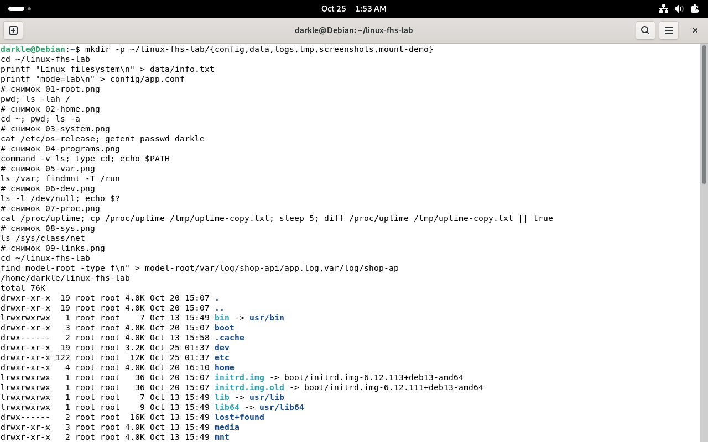

Результат: …

Что такое корневой каталог, чем абсолютный путь отличается от относительного.

Вывод: Корневой каталог `/` — вершина единого дерева файловой системы Linux. Абсолютный путь всегда начинается с `/` и однозначен; относительный задаётся от текущего каталога (`pwd`) и меняется при `cd`.

## Домашний каталог

Команды:

```bash
cd ~, pwd, ls -a
```

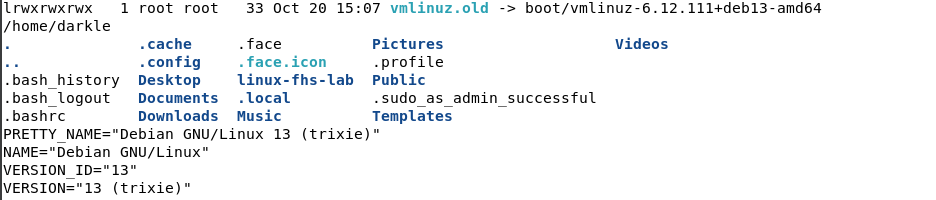

Результат: …

Где находится домашний каталог, что такое скрытые файлы.

Вывод: Домашний каталог пользователя — `/home/имя` (для root — `/root`). Скрытые файлы и каталоги начинаются с точки; без ключа `-a` команда `ls` их не показывает.

## Каталог /etc

Команды:

```bash
cat /etc/os-release; getent passwd
```

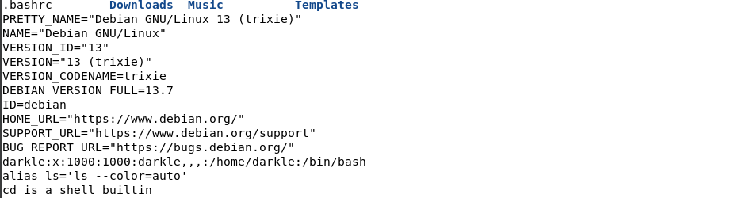

Результат: …

Версия системы, UID, домашний каталог и оболочка.

Вывод: В `/etc/os-release` — сведения о дистрибутиве; `getent passwd` читает учётные записи (UID, домашний каталог, оболочка).

## Программы и PATH

Команды:

```bash
command -v, type, echo $PATH
```

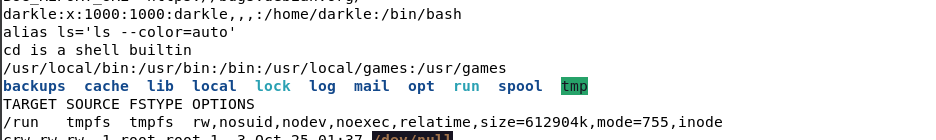

Результат: …

Как оболочка находит программу.

Вывод: Внешние команды ищутся по каталогам из `$PATH` слева направо; встроенные (`type cd` → builtin) выполняет сама оболочка.

## Изменяемые данные

Команды:

```bash
ls /var; findmnt -T /run
```

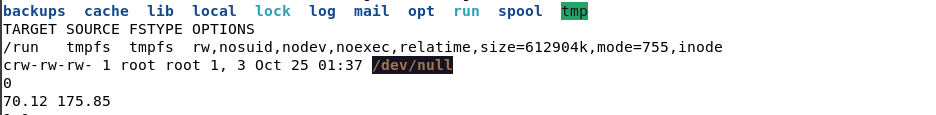

Результат: …

Назначение /var/lib, /var/log, /var/cache и /run.

Вывод: `/var/lib` — постоянные данные служб; `/var/log` — журналы; `/var/cache` — кэш; `/run` — volatile-данные работающей системы (часто tmpfs), очищается при перезагрузке.

## Устройства

Команды:

```bash
ls -l /dev/null; echo $?
```

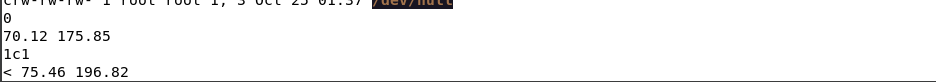

Результат: …

Тип устройства и код завершения.

Вывод: `/dev/null` — символьное устройство (`c`); запись в него отбрасывается. `$?` после успешной команды — `0`.

## Файлы /proc

Команды:

```bash
cat /proc/uptime; cp; sleep 5
```

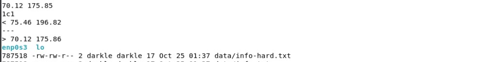

Результат: …

Почему копия не меняется.

Вывод: Содержимое `/proc` формирует ядро при каждом чтении. Копия в обычный файл — снимок на момент `cp`; после `sleep` живой `/proc/uptime` уже другой.

## Сетевые интерфейсы

Команды:

```bash
ls /sys/class/net
```

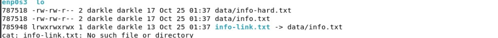

Результат: …

Какие интерфейсы есть в системе.

Вывод: В `/sys/class/net` перечислены сетевые интерфейсы (например `lo`, `enp0s3` — зависит от ВМ).

## inode и ссылки

Команды:

```bash
ls -li; rm data/info.txt; cat info-link.txt
```

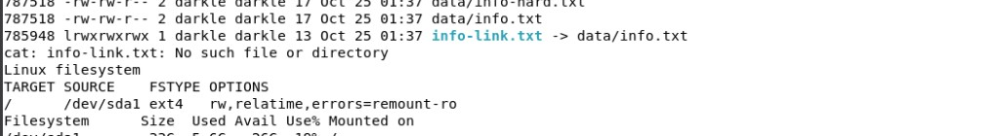

Результат: …

Чем жёсткая ссылка отличается от символической.

Вывод: Жёсткая ссылка — второе имя того же inode; данные живы, пока есть хотя бы одно имя. Символическая ссылка хранит путь; при удалении цели чтение через symlink ломается, через жёсткую ссылку — нет.

## Место на диске

Команды:

```bash
findmnt /; df -h .; du -sh data
```

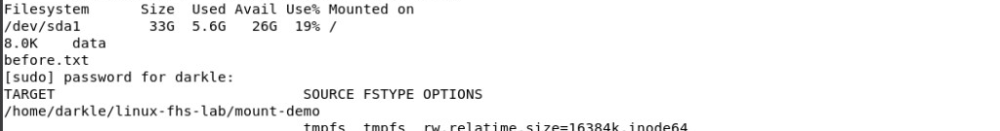

Результат: …

Чем df отличается от du.

Вывод: `df` — свободное/занятое место на всей файловой системе точки монтирования; `du` — суммарный размер конкретного каталога.

## Монтирование tmpfs

Команды:

```bash
findmnt -T mount-demo
```

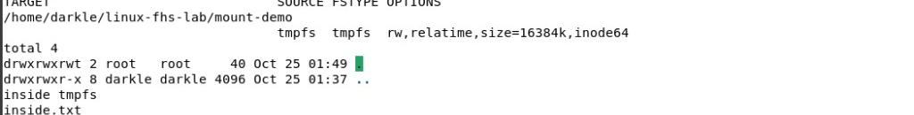

Результат: …

Почему before.txt перестал быть виден.

Вывод: После `mount` каталог стал точкой монтирования tmpfs; видно содержимое tmpfs, файлы нижнего слоя (`before.txt`) временно скрыты.

## Отключение tmpfs

Команды:

```bash
cat mount-demo/before.txt
```

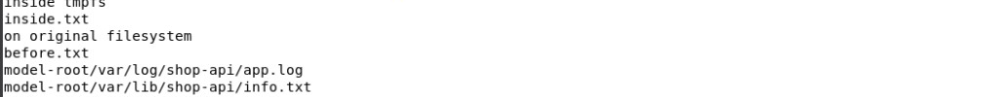

Результат: …

Что стало с inside.txt.

Вывод: После `umount` снова виден `before.txt`. `inside.txt` жил в tmpfs в RAM и исчез вместе с отмонтированием.

## Файлы shop-api

Команды:

```bash
find model-root -type f
```


Результат: …

Почему выбран каждый каталог.

Вывод: Настройки — `etc/shop-api`, данные — `var/lib/shop-api`, журнал — `var/log/shop-api` — по FHS и типу данных.

## Размещение shop-api (модель)

| Файл | Каталог | Основание |
|---|---|---|
| Исполняемый файл | `/usr/local/bin` | программа вне пакетов дистрибутива |
| Настройки | `/etc/shop-api` | конфигурационные файлы |
| База данных | `/var/lib/shop-api` | постоянные изменяемые данные |
| Журнал | `/var/log/shop-api` | журналы службы |
| Номер процесса | `/run/shop-api` | сведения о работающей службе до перезагрузки |

## Итоговая задача

| Путь в системе | Оставить / заменить | Правильный путь | Основание (часть урока) |
|---|---|---|---|
| `/home/admin/shop.log` | заменить | `/var/log/shop-api/access.log` (или `app.log`) | журнал — `/var/log`, не домашний каталог (ч. 4, 8) |
| `/usr/bin/config.json` | заменить | `/etc/shop-api/app.conf` | настройки — `/etc`, не каталог программ (ч. 2, 8) |
| `/tmp/database.db` | заменить | `/var/lib/shop-api/database.db` | БД постоянная — `/var/lib`, не `/tmp` (ч. 4, 8) |
| `/etc/shop-api/app.conf` | оставить | `/etc/shop-api/app.conf` | конфигурация по FHS |
| `/var/log/shop-api/access.log` | оставить | `/var/log/shop-api/access.log` | журнал службы |
| `/var/lib/shop-api/database.db` | оставить | `/var/lib/shop-api/database.db` | данные службы |

## Домашнее задание · backup-agent

| Файл / данные | Каталог | Основание |
|---|---|---|
| Программа `backup-agent` | `/usr/local/bin/backup-agent` | ПО, установленное вручную, вне пакетов — `/usr/local/bin` |
| Настройки | `/etc/backup-agent/` | Конфигурационные файлы — `/etc` |
| Журнал работы | `/var/log/backup-agent/backup.log` | Журналы служб — `/var/log` |
| Список сделанных копий (метаданные) | `/var/lib/backup-agent/` | Постоянные данные приложения — `/var/lib` |
| Номер процесса (PID-файл) | `/run/backup-agent/backup-agent.pid` | Сведения о работающем процессе — `/run` (tmpfs) |

Сами архивы резервных копий хранятся на отдельном носителе (вне этой таблицы размещения в FHS).

## Практика-тест · тема 03

Код результата (после прохождения теста на сайте занятия 3):

```
…
```

## Перед сдачей

- [ ] tmpfs отключена или ошибка `sudo` описана в отчёте
- [ ] Снимки открываются из `report.md`
- [ ] Результаты получены в моей системе (Debian ВМ)
- [ ] Работа сохранена на внешнем носителе (при необходимости)
