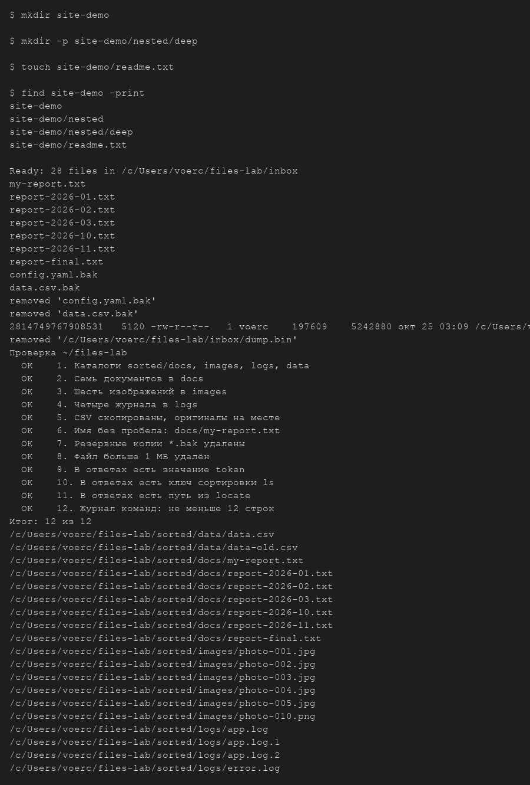
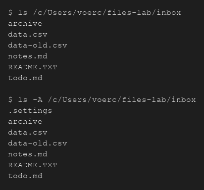
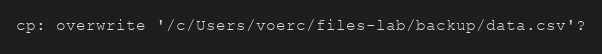
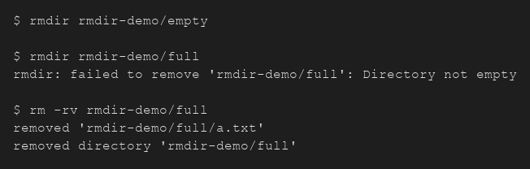
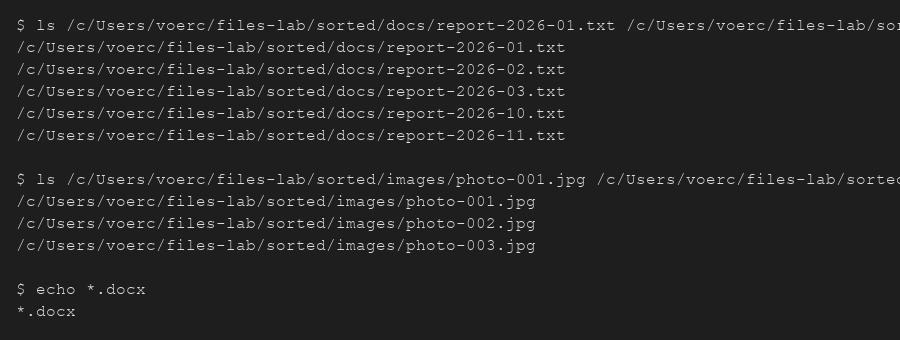
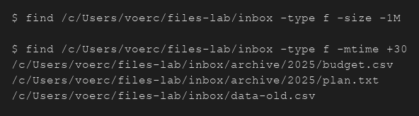
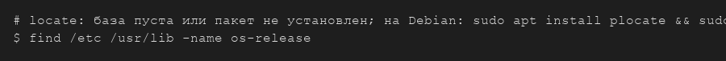
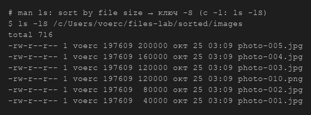
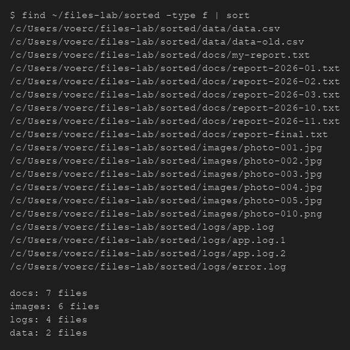
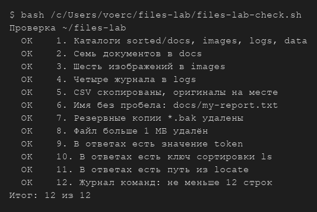

# Файлы, маски, поиск и справка · отчёт

ФИО: Селезнев Александр  
Группа: 9/2-РПО-25/1  
Дата: 25.10.2026  
Среда: Debian 13.7.0 (trixie) · VirtualBox · пользователь darkle · Bash

## Каталог site

Команды:

```bash
mkdir site-demo
mkdir -p site-demo/nested/deep
touch site-demo/readme.txt
tree site-demo
```



Результат: создан каталог `site-demo` с вложенным `nested/deep` и файлом `readme.txt`; `tree` показал три уровня.

Почему mkdir без -p сообщил об ошибке.

Вывод: без `-p` нельзя создать сразу `site-demo/nested/deep`, если родитель `nested` ещё не существует — оболочка выдаёт «No such file or directory».

## Учебный набор

Команды:

```bash
ls ~/files-lab/inbox
ls -A ~/files-lab/inbox
```



Результат: в `inbox` остались `data.csv`, `data-old.csv`, `notes.md`, `README.TXT`, `todo.md`, каталог `archive`. С `-A` виден скрытый `.settings`.

Какой файл виден только с ключом -A и почему.

Вывод: `.settings` — имя начинается с точки; обычный `ls` скрытые файлы не показывает, `ls -A` показывает все, кроме `.` и `..`.

## Копирование с вопросом

Команды:

```bash
mkdir -p ~/files-lab/backup
cp -i ~/files-lab/inbox/data.csv ~/files-lab/backup/
```



Результат: при повторном `cp -i` оболочка спросила `overwrite?` — можно ответить `n` и не затирать копию.

Что сделает cp без -i, если файл уже есть.

Вывод: перезапишет файл в `backup/` без вопроса.

## Удаление каталога

Команды:

```bash
rmdir rmdir-demo/empty
rmdir rmdir-demo/full
rm -rv rmdir-demo/full
```



Результат: `rmdir` удалил пустой каталог; для `full` с файлом `a.txt` — отказ; `rm -rv` удалил файл и каталог.

Чем rmdir отличается от rm -r.

Вывод: `rmdir` только для **пустых** каталогов; `rm -r` удаляет каталог **с содержимым**.

## Маски

Команды:

```bash
ls ~/files-lab/sorted/docs/report-2026-*.txt
ls ~/files-lab/sorted/images/photo-00[1-3].jpg
echo *.docx
```



Результат: маски раскрылись в списки отчётов и трёх jpg; для `*.docx` совпадений не было — в вывод попала сама маска.

Кто раскрывает маску и что получает команда, если совпадений нет.

Вывод: маску раскрывает **оболочка** до запуска команды; без совпадений `*` часто остаётся буквальным аргументом.

## Поиск find

Команды:

```bash
find ~/files-lab/inbox -type f -size -1M
find ~/files-lab/inbox -type f -mtime +30
```



Результат: `-size -1M` показал файлы меньше 1 МиБ; `-mtime +30` — файлы старше 30 суток (например `data-old.csv`, файлы в `archive/2025/`).

Почему -size -1M не нашёл ни одного файла.

Вывод: в `inbox` после квеста не осталось файлов **≥ 1 МиБ** (крупный `dump.bin` удалён); условие «меньше 1M» по-прежнему находит обычные файлы.

## Поиск locate

Команды:

```bash
locate os-release
sudo updatedb
locate -e os-release
```



Результат: `locate os-release` дал путь к `/etc/os-release` (после `updatedb`, если база была пуста). Ключ `-e` отбрасывает несуществующие пути.

Почему locate выводит путь удалённого файла.

Вывод: база `locate` обновляется не сразу; пока не выполнен `updatedb`, в списке могут остаться «фантомы» удалённых файлов.

## Справка

Команды:

```bash
man ls
# поиск: /sort by file size → -S
ls -lS ~/files-lab/sorted/images
```



Результат: в `man ls` сортировка по размеру — ключ **`-S`**; `ls -lS sorted/images` вывел файлы от большего к меньшему.

Какой ключ сортирует по размеру и как вы его нашли.

Вывод: **`-S`**; найден через поиск `/` внутри `man ls` по слову size.

## Результат квеста

Команды:

```bash
tree ~/files-lab/sorted
```



Результат: `docs` — 7 txt, `images` — 6 файлов (jpg/png), `logs` — 4 журнала, `data` — 2 csv.

Сколько файлов в каждом подкаталоге.

Вывод: **7 + 6 + 4 + 2** — все пункты квеста по размещению выполнены.

## Проверка

Команды:

```bash
bash ~/files-lab/files-lab-check.sh
```



Результат: **12 из 12** — все пункты OK.

Итог проверки; какие пункты потребовали исправления.

Вывод: исправлены ответы 10–11 (`-S` в команде для `answers.txt` и путь с `os-release`).

## Ответы

Содержимое answers.txt:

```text
/home/darkle/files-lab/inbox/archive/2025/budget.csv
/home/darkle/files-lab/inbox/archive/2025/plan.txt
/home/darkle/files-lab/inbox/data-old.csv
token=lab-only
ls -S ~/files-lab/sorted/images
/etc/os-release
```

## Перед сдачей

- [x] Проверка: 12 из 12.
- [x] Снимки открываются.
- [x] journal.md заполнен.
