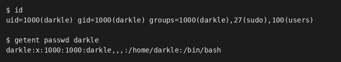
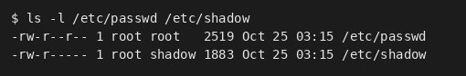
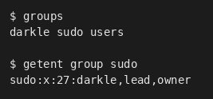
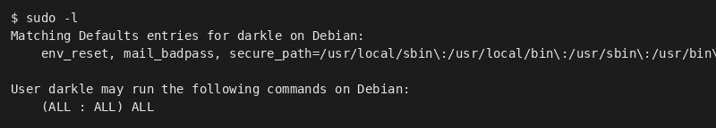
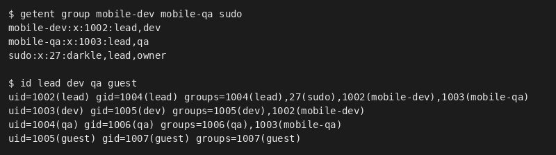
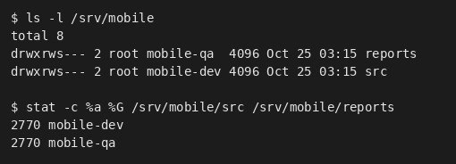
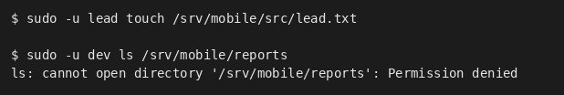
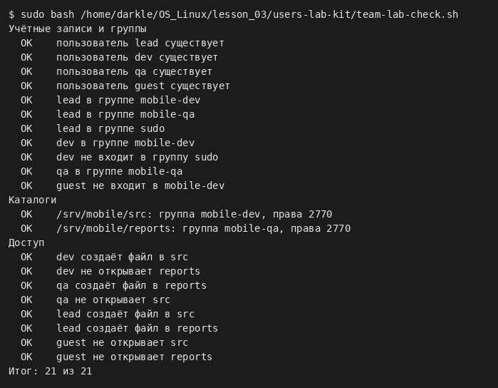
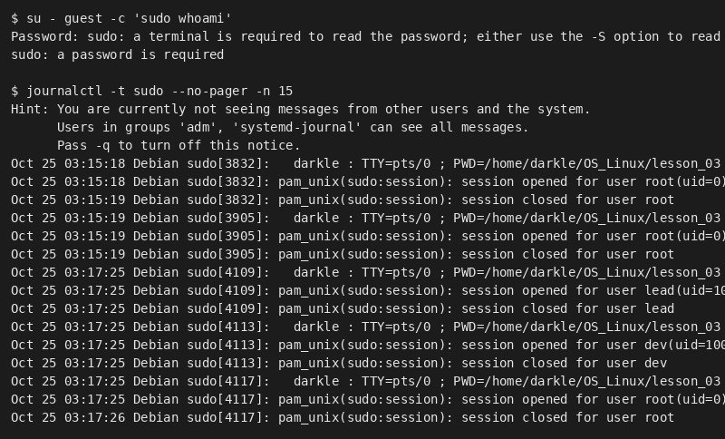
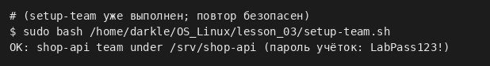

# Пользователи, группы и sudo · отчёт

ФИО: Селезнев Александр  
Группа: 9/2-РПО-25/1  
Дата: …  
Среда: Debian 13.7.0 (trixie) · VirtualBox · пользователь darkle · Bash

## Учётная запись

Команды:

```bash
id, getent passwd $(whoami)
```



Результат: …

Подпишите семь полей своей строки /etc/passwd.

Вывод: …

## passwd и shadow

Команды:

```bash
ls -l /etc/passwd /etc/shadow
```



Результат: …

Почему shadow закрыт для остальных пользователей.

Вывод: …

## Группы

Команды:

```bash
groups, getent group sudo
```



Результат: …

Где основная группа, где дополнительные.

Вывод: …

## Правила sudo

Команды:

```bash
sudo -l
```



Результат: …

Какое правило даёт вам права администратора.

Вывод: …

## Команда mobile-app

Команды:

```bash
getent group mobile-dev mobile-qa sudo
id lead dev qa guest
```



Результат: …

Совпадают ли группы со схемой ролей.

Вывод: …

## Каталоги проекта

Команды:

```bash
ls -l /srv/mobile
stat -c '%a %G' /srv/mobile/src /srv/mobile/reports
```



Результат: …

Что означает каждая цифра в 2770.

Вывод: …

## Тесты доступа

Команды:

```bash
sudo -u lead touch /srv/mobile/src/lead.txt
sudo -u dev ls /srv/mobile/reports
```



Результат: …

Результаты таблицы тестов доступа.

Вывод: …

## Проверка

Команды:

```bash
sudo bash users-lab-kit/team-lab-check.sh
```



Результат: …

Итог проверки; какие пункты потребовали исправления.

Вывод: …

## Отказ sudo в журнале

Команды:

```bash
journalctl -t sudo | grep -i "not in sudoers"
```



Результат: …

Кто, когда и какую команду пытался выполнить.

Вывод: …

## setup-team.sh (свой проект)



Результат: …

## Почему постоянная работа под root опасна

1. …
2. …
3. …

## Практика-тест · темы 04–05

Код результата:

```
…
```

## Перед сдачей

- [ ] Проверка: 21 из 21.
- [ ] access-tests.md заполнен.
- [ ] access-model.md и setup-team.sh проверены на ВМ.
- [ ] Код теста 04–05 в отчёте.
