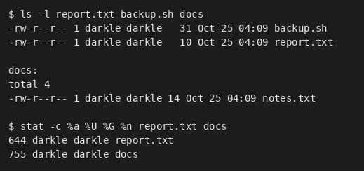
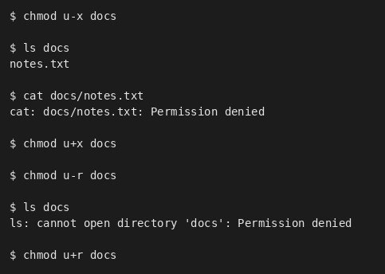
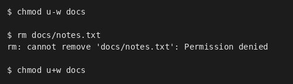
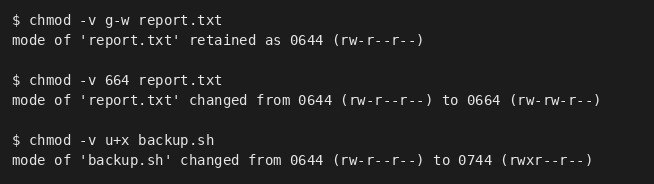
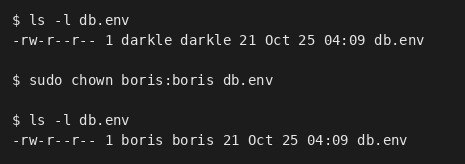
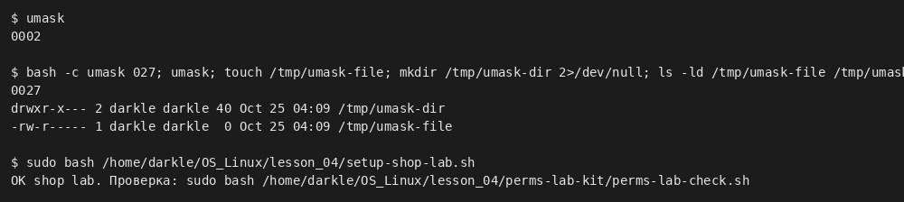
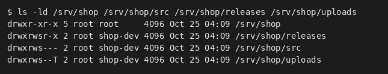
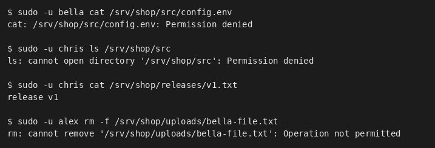
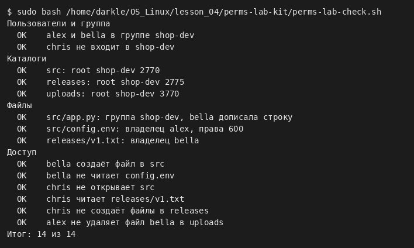

# Права доступа, владельцы и umask · отчёт

ФИО: Селезнев Александр  
Группа: 9/2-РПО-25/1  
Дата: …  
Среда: Debian 13.7.0 (trixie) · VirtualBox · пользователь darkle · Bash

## Строка ls -l

Команды:

```bash
ls -l, stat -c '%a %U %G %n'
```



Результат: …

Подпишите поля одной строки: тип, три тройки, владелец, группа.

Вывод: …

## Каталог без x и без r

Команды:

```bash
chmod u-x docs; ls docs; cat docs/notes.txt
chmod u-r docs; ls docs
```



Результат: …

Объясните каждую ошибку: что запрещено без x и без r.

Вывод: …

## Удаление и право w

Команды:

```bash
chmod u-w docs; rm docs/notes.txt
```



Результат: …

Почему удаление файла решает каталог, а не файл.

Вывод: …

## chmod буквами и числом

Команды:

```bash
chmod -v g-w report.txt; chmod -v 664 report.txt
```



Результат: …

Переведите три своих примера из букв в число и обратно.

Вывод: …

## Владелец и группа

Команды:

```bash
sudo chown boris:boris db.env
```



Результат: …

Почему chown без sudo запрещён, а chgrp на свою группу разрешён.

Вывод: …

## umask

Команды:

```bash
umask; (umask 027; touch …; mkdir …)
```



Результат: …

Права файла и каталога при маске 0027 — расчёт по тройкам.

Вывод: …

## Каталоги проекта

Команды:

```bash
ls -ld /srv/shop/*
```



Результат: …

Что означает каждая буква в drwxrws--T.

Вывод: …

## Тесты доступа

Команды:

```bash
sudo -u bella cat …/config.env
sudo -u chris ls /srv/shop/src
sudo -u alex rm …/uploads/…
```



Результат: …

Какой бит или право объясняет каждый результат.

Вывод: …

## Проверка

Команды:

```bash
sudo bash perms-lab-kit/perms-lab-check.sh
```



Результат: …

Итог проверки; какие пункты потребовали исправления.

Вывод: …

## Перед сдачей

- [ ] Проверка: 14 из 14.
- [ ] Под каждым снимком есть вывод.
- [ ] permissions.md заполнен.
