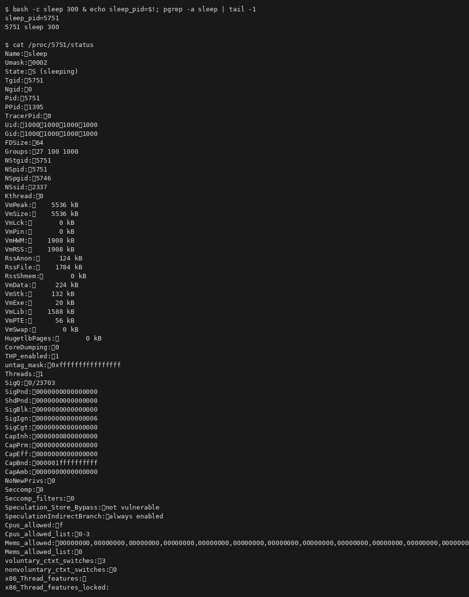
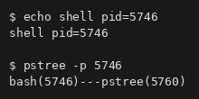
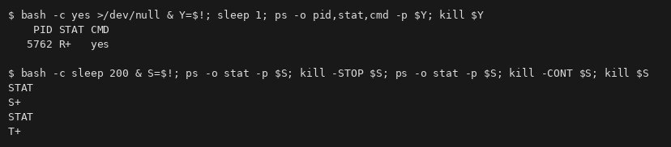
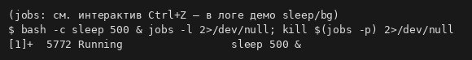
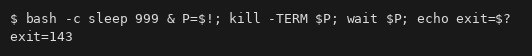
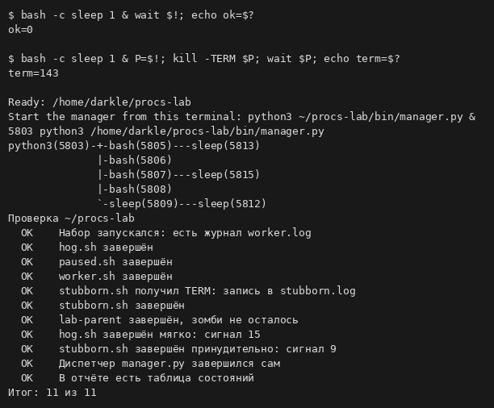
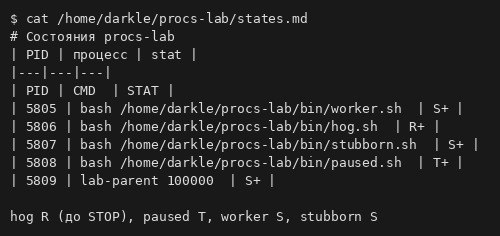
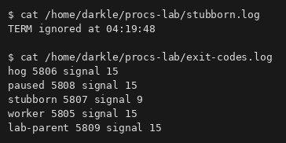
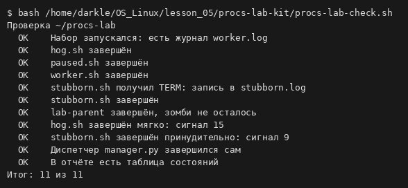
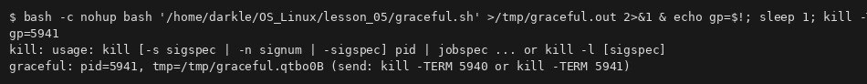

# Процессы: PID, состояния и сигналы · отчёт

ФИО: Селезнев Александр  
Группа: 9/2-РПО-25/1  
Дата: 25.10.2026  
Среда: Debian 13.7.0 (trixie) · VirtualBox · пользователь darkle · Bash

## Программа и процесс

Команды:

```bash
sleep 300 & echo sleep_pid=$!; pgrep -a sleep
cat /proc/$PID/status | head -15
```



Результат: фоновый `sleep` (PID 5751), в `/proc/.../status` — Name, State **S**, Pid, PPid, Uid.

Вывод: исполняемый файл на диске — программа; экземпляр в памяти с PID — процесс.

## Дерево процессов

Команды:

```bash
echo shell pid=$$
pstree -p $$
```



Результат: оболочка bash с PID 5746; `pstree` показывает дочерний процесс.

Вывод: у процесса есть PPID; `pstree -p` рисует дерево по PID.

## Состояния

Команды:

```bash
yes >/dev/null & … ps -o pid,stat,cmd
sleep 200 & … kill -STOP; ps; kill -CONT
```



Результат: `yes` в **R+**; `sleep` сначала **S+**, после STOP — **T+**, после CONT снова можно завершить.

Вывод: **R** — выполняется; **S** — ожидание; **T** — остановлен сигналом (STOP).

## Фон и передний план

Команды:

```bash
sleep 500 & jobs -l
```



Результат: задание `[1]+ 5772 Running sleep 500 &`.

Вывод: `&` уводит процесс в фон; `jobs -l` показывает номер задания и PID.

## STOP, CONT и trap

Команды:

```bash
sleep 999 & kill -TERM $P; wait $P; echo exit=$?
```



Результат: после SIGTERM у `sleep` код **exit=143** (128+15).

Вывод: TERM просит процесс завершиться; код 143 — стандартный для «убит по TERM».

## Коды завершения

Команды:

```bash
sleep 1 & wait $!; echo ok=$?
sleep 1 & kill -TERM; wait; echo term=$?
```



Результат: нормальное завершение **ok=0**; TERM у sleep **term=143**; в логе procs-lab — **11 из 11**.

Вывод: **130** = Ctrl+C; **143** = TERM (128+15); **137** = KILL (128+9).

## Набор процессов

Команды:

```bash
python3 ~/procs-lab/bin/manager.py &
cat ~/procs-lab/states.md
```



Результат: таблица PID/CMD/stat — hog **R+**, paused **T+**, worker/stubborn/lab-parent **S+**.

Вывод: см. `states.md`.

## Сигналы по заданиям

Команды:

```bash
cat ~/procs-lab/stubborn.log
cat ~/procs-lab/exit-codes.log
```



Результат: `TERM ignored` у stubborn; hog/paused/worker/lab-parent — сигнал **15**, stubborn — **9** после KILL.

Вывод: игнор TERM требует SIGKILL; диспетчер фиксирует коды в `exit-codes.log`.

## Проверка

Команды:

```bash
bash ~/OS_Linux/lesson_05/procs-lab-kit/procs-lab-check.sh
```



Результат: все пункты **OK**, **Итог: 11 из 11**.

Вывод: набор procs-lab пройден полностью.

## graceful.sh

Команды:

```bash
nohup bash graceful.sh … & kill -TERM …
bash graceful.sh &; kill -TERM/KILL; wait; echo $?
```



Результат: скрипт пишет pid и путь temp-файла; на TERM — очистка и код **0**; на KILL после `wait` — **137**.

Вывод: `trap` обрабатывает TERM; KILL не перехватывается.

## Перед сдачей

- [x] Проверка: 11 из 11.
- [x] states.md и processes.md заполнены.
