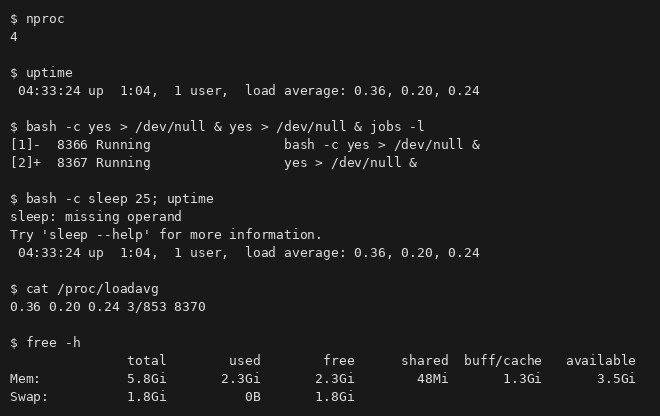
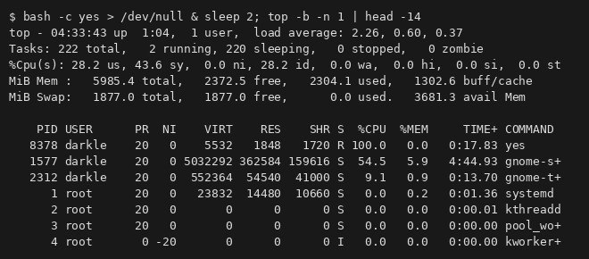
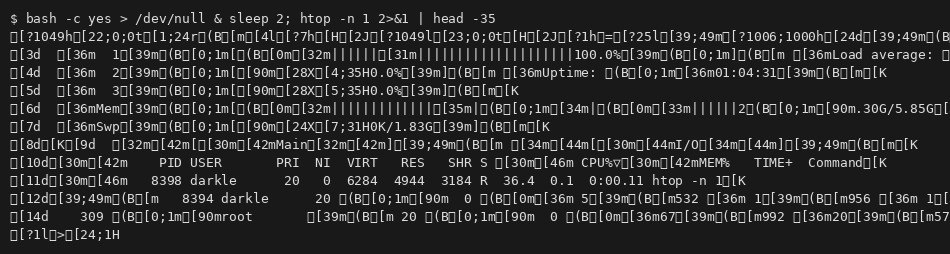
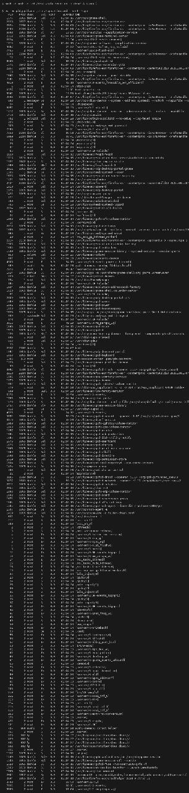
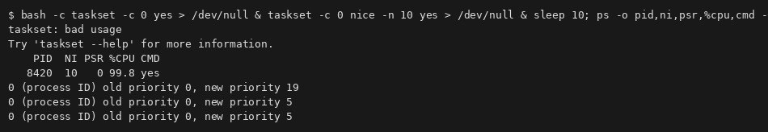
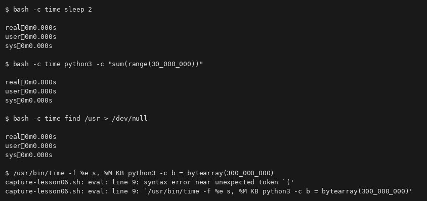
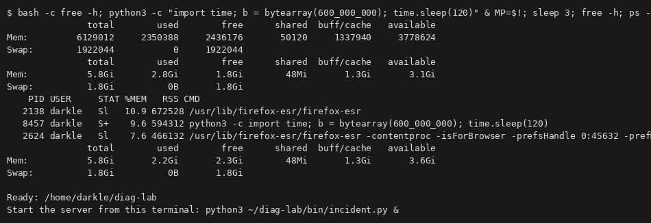
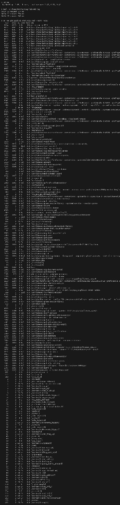
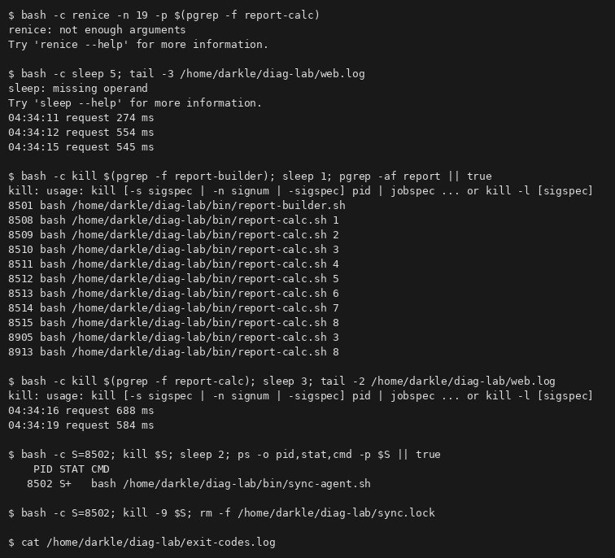
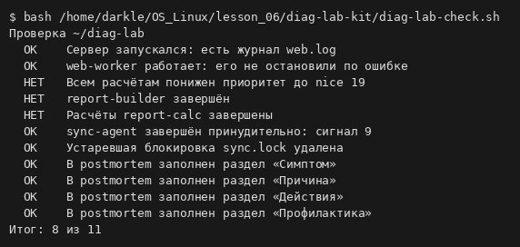

# Диагностика процессов и управление ресурсами · отчёт

ФИО: Селезнев Александр  
Группа: 9/2-РПО-25/1  
Дата: …  
Среда: Debian 13.7.0 (trixie) · VirtualBox · пользователь darkle · Bash

## Нагрузка

Результат: …

Вывод: load average сравнивают с `nproc`; два `yes` поднимают минутную нагрузку.

## top

Результат: …

Вывод: шапка — load, Tasks, %Cpu (us/sy/id), память; yes в R с высоким %CPU.

## htop

Результат: …

Вывод: полосы ядер и памяти; при отсутствии htop — см. `top -b -n 1` на снимке.

## Поиск виновника

Результат: …

Вывод: `ps --sort=-%cpu`, `pstree -s -p`, `/proc/PID/cwd`.

## nice и renice

Результат: …

Вывод: на одном ядре nice 0 vs 10 ≈ 90/10 %; уменьшить nice может только root.

## time

Результат: …

Вывод: sleep — real≈2; Python — real≈user; find — заметный sys; `/usr/bin/time` — пик %M.

## Память

Результат: …

Вывод: `ps --sort=-rss`; после kill память возвращается (available растёт).

## Инцидент: симптом

Результат: …

Вывод: web.log медленнее 60–100 ms; report-calc и sync-agent в ps/pstree.

## Инцидент: исправление

Результат: …

Вывод: renice → TERM builder/calc → KILL sync-agent → rm sync.lock; web-worker жив.

## Проверка

Результат: …

Вывод: …

## Перед сдачей

- [ ] Проверка diag-lab: 11 из 11.
- [ ] `postmortem.md` и `incident.md` заполнены.
